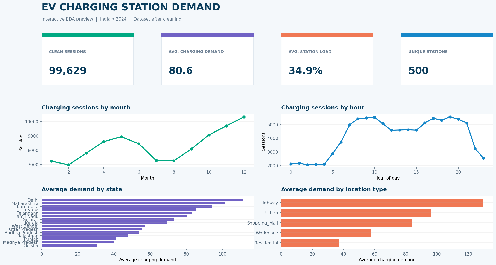
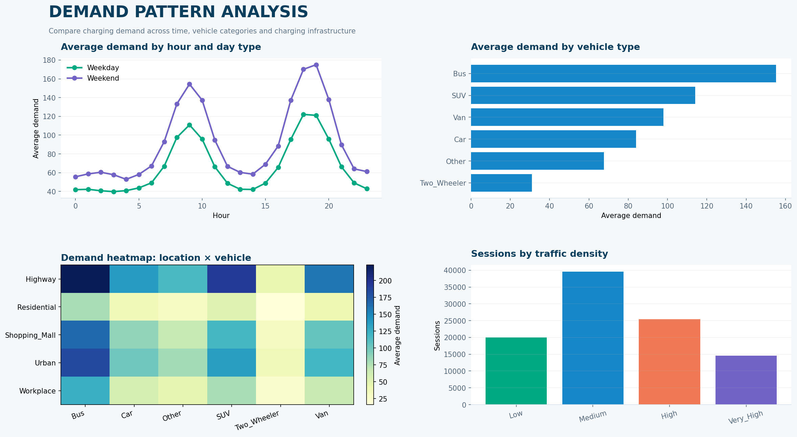
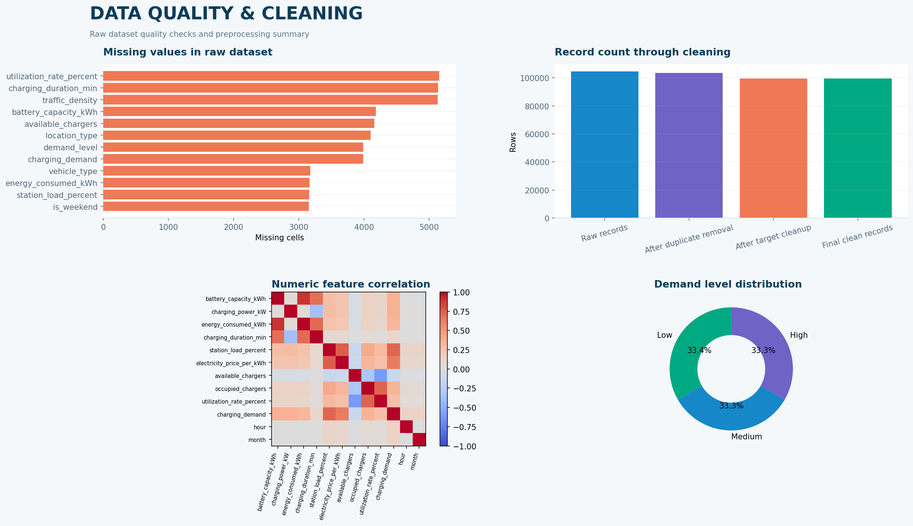
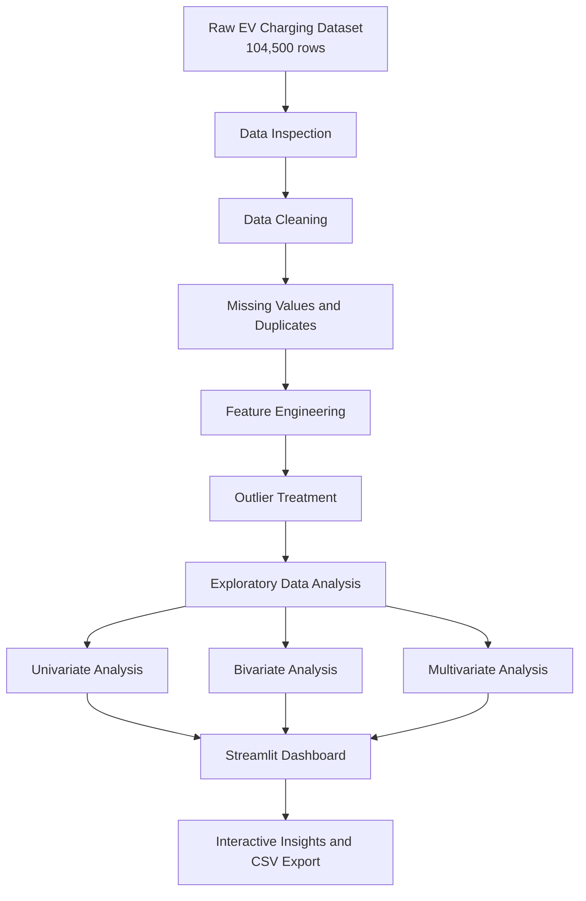

# ⚡ EV Charging Station Demand & Network Planning

An interactive **Exploratory Data Analysis (EDA)** project built with **Python, Pandas, NumPy, Plotly and Streamlit**. The project analyzes EV charging sessions across India to understand demand patterns by time, state, location, vehicle type, charger type and traffic density.

The Streamlit dashboard turns the cleaned dataset into interactive charts, filters, data-quality checks and pivot tables that can support EV charging station planning and operational decisions.

## 🧩 Problem Statement / Business Problem

With the growing adoption of electric vehicles, understanding charging demand is important for planning charging stations. This project analyzes EV charging data to identify demand patterns across time, locations and vehicle types, helping support better station utilization and network-planning decisions.

The business problem addressed by this project is:

**How can EV charging-session data be analyzed and presented so that planners and operators can make more informed decisions about charging demand, station utilization and potential network expansion?**

## 🎯 Project Objectives

1. **Understand demand patterns:** Analyze charging sessions by hour, day of week and month to identify periods of higher activity.
2. **Compare geographic demand:** Explore differences in charging demand across states and location categories such as residential, highway, workplace and shopping-mall locations.
3. **Compare EV and charger categories:** Examine demand across vehicle types and charger types to understand differences in charging behavior.
4. **Evaluate station utilization:** Explore station load, occupied and available chargers, and utilization-related measures to understand usage patterns.
5. **Assess related factors:** Compare demand with traffic density, peak-hour status and other available dataset attributes.
6. **Improve data reliability:** Inspect missing values, duplicate records and outliers, then apply documented cleaning and preprocessing steps.
7. **Support business decisions:** Present findings through interactive filters, charts and pivot tables that can help stakeholders investigate capacity planning and potential areas for further analysis.

## 📊 Dashboard Preview

### 1. Overview Dashboard



### 2. Demand Pattern Analysis



### 3. Data Quality and Cleaning



> These images are static preview snapshots generated from the supplied dataset. Run the Streamlit application to use the interactive filters, tabs and charts.

## 🎯 Project Objectives

- Analyze EV charging demand across different Indian states and location categories.
- Identify hourly, daily and monthly charging-session patterns.
- Compare demand across vehicle and charger types.
- Examine the relationship between charging demand, station load, utilization and traffic density.
- Detect missing values, duplicate records and outliers.
- Present findings through an interactive dashboard to support network-planning decisions.

## 🗂️ Dataset

- **Source file:** `EV_Charging_Station_Demand_104500_with_NaN.csv`
- **Raw records:** 104,500
- **Columns:** 20
- **Coverage:** EV charging sessions across Indian states during 2024.
- **Data types:** Numerical, categorical, Boolean and timestamp fields.

Important fields include:

| Category | Example columns |
|---|---|
| Time | `timestamp`, `is_weekend`, `peak_hour` |
| Station and geography | `station_id`, `state`, `location_type` |
| EV and charger | `vehicle_type`, `charger_type` |
| Traffic | `traffic_density` |
| Charging metrics | `battery_capacity_kWh`, `charging_power_kW`, `energy_consumed_kWh`, `charging_duration_min` |
| Station utilization | `station_load_percent`, `available_chargers`, `occupied_chargers`, `utilization_rate_percent` |
| Target / outcome | `charging_demand`, `demand_level` |

## 🧹 Data Cleaning & Preprocessing

The dashboard applies the following cleaning pipeline to the raw dataset:

1. Remove duplicate records.
2. Drop records where the target field `charging_demand` is missing.
3. Fill missing categorical values using the mode.
4. Impute battery capacity, energy consumed and charging duration using the median within each vehicle type.
5. Impute charging power using the median within each charger type.
6. Convert the timestamp to datetime and derive hour, month, day of week and weekend indicators.
7. Fill missing peak-hour values using the configured peak-hour rule (08:00–10:00 and 17:00–20:00).
8. Fill remaining missing numerical values using column medians.
9. Cap selected outliers in `station_load_percent` and `occupied_chargers` using the IQR method.
10. Create Low, Medium and High demand groups using quantile-based bins.

**Cleaning result:** 99,629 records remain after the dashboard's duplicate and missing-target removal steps. The app also reports the raw missing-value counts and cleaning summary in its Data Quality tab.

## 📈 Dashboard Features

The Streamlit app includes eight tabs:

| Tab | Features |
|---|---|
| Overview | KPI metrics, monthly and hourly sessions, state-wise and location-wise demand |
| Data | Filtered data preview, descriptive statistics, column information and CSV export |
| Data quality | Missing-value summary, cleaning metrics, IQR outlier checks and box plots |
| Univariate | Numerical distributions, categorical counts, demand levels and time trends |
| Bivariate | Demand comparisons by category, scatter plots and state/hour comparisons |
| Multivariate | Correlation heatmap, feature comparisons and three-variable scatter plots |
| Pivot tables | Pre-built and user-configurable pivot tables |
| Key findings | Summary observations from the analysis |

**Interactive filters:** State, location type, vehicle type, charger type, traffic density, peak-hour status, weekday/weekend and month.

## 🔄 Project Workflow



## 🛠️ Tech Stack

- **Python** – core programming
- **Pandas** – data manipulation and cleaning
- **NumPy** – numerical operations
- **Plotly Express / Graph Objects** – interactive visualizations
- **Matplotlib** – supporting visualizations
- **Streamlit** – interactive dashboard
- **Jupyter Notebook** – EDA development and analysis

## 📁 Project Structure

```text
EV_Dashboard/
│
├── app.py
├── EV_Charging_Station_Demand_104500_with_NaN.csv
├── Final_EDA_EV_Project.ipynb
├── requirements.txt
├── background.jpg
├── banner.jpg
├── config.toml
├── .gitignore
├── README.md
│
└── dashboard_images/
    ├── 01_dashboard_overview.png
    ├── 02_demand_analysis.png
    └── 03_data_quality.png
```

## ▶️ Run the Project Locally

### 1. Clone the repository

```bash
git clone <your-github-repository-url>
cd EV_Dashboard
```

### 2. Create and activate a virtual environment (recommended)

**Windows:**

```bash
python -m venv venv
venv\Scripts\activate
```

**macOS / Linux:**

```bash
python3 -m venv venv
source venv/bin/activate
```

### 3. Install dependencies

```bash
pip install -r requirements.txt
```

### 4. Run the Streamlit dashboard

```bash
streamlit run app.py
```

Streamlit will provide a local URL (usually `http://localhost:8501`) to open the dashboard in your browser.

> Keep `app.py` and the CSV dataset in the same project directory. The dashboard reads the CSV file from that directory.

## 📌 Potential Use Cases

- Identify high-demand hours and periods.
- Compare charging demand across states and location types.
- Understand charging requirements across vehicle categories.
- Review station load and charger utilization patterns.
- Support decisions about where and when charging capacity may need attention.

## 👩‍💻 Author

**Your Name**  
Add your LinkedIn and GitHub profile links here.

---

If you find this project useful, feel free to ⭐ the repository.
